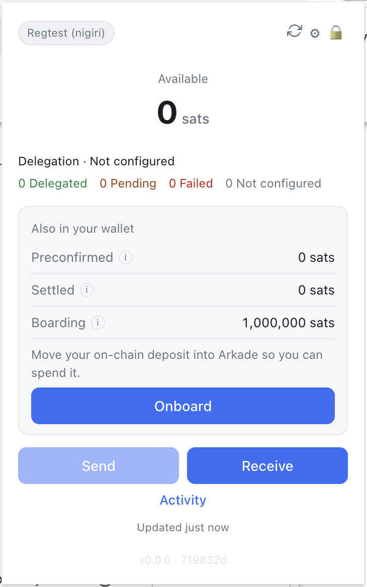
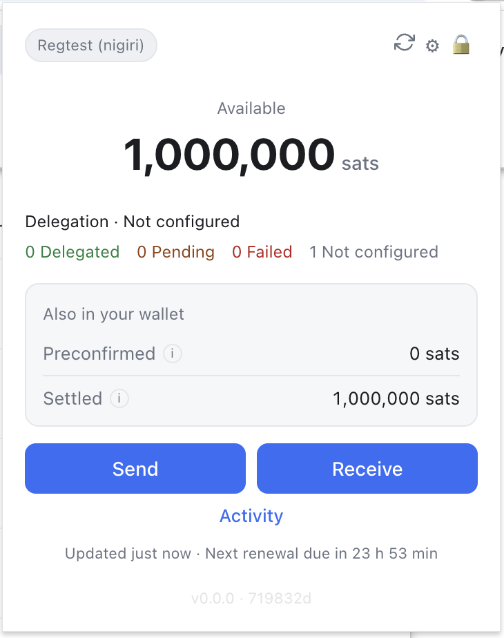
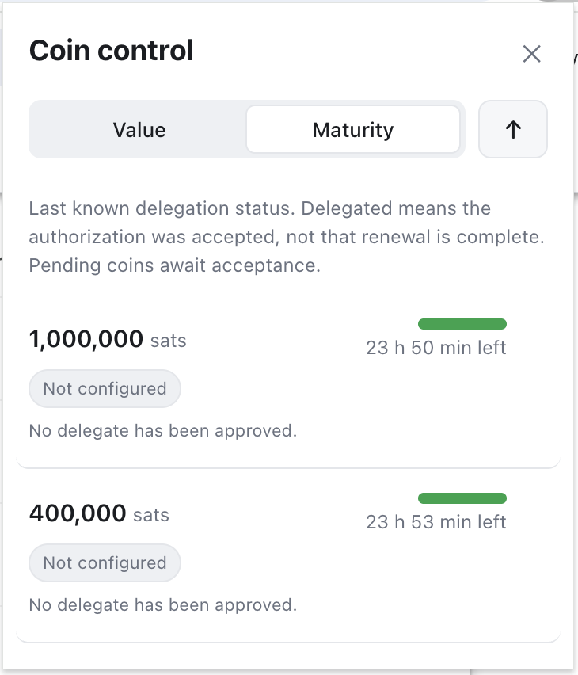

<p align="center">
  
</p>

<h1 align="center">Arkade Wallet Extension</h1>

<p align="center">
  A Bitcoin wallet for <a href="https://arkadeos.com">Arkade</a>, right in your browser toolbar.<br/>
  Fast off-chain payments, full control over every coin, and a provider dapps can talk to.
</p>

<table align="center">
  <tr>
    <td valign="top"></td>
    <td valign="top"></td>
    <td valign="top"></td>
  </tr>
  <tr>
    <td align="center"><sub>Board an on-chain deposit</sub></td>
    <td align="center"><sub>Spend it off-chain</sub></td>
    <td align="center"><sub>See every coin and its lifetime</sub></td>
  </tr>
</table>

> [!WARNING]
> This wallet is alpha software and has not been tested on mainnet. Use test networks, or only
> amounts you can afford to lose.

## Why

- **Coin control.** Every VTXO is listed with its value and time left before renewal; pick the exact coins you spend.
- **Built for dapps.** Pages get a `window.arkadeWallet` provider to connect, read balances, and request signatures.
- **Self-custodial, MV3-native.** The `@arkade-os/sdk` wallet runs in the extension's service worker, with state persisted to IndexedDB.

## Status

✅ Done · 🚧 In progress · ⬜ Planned · ⛔ Deprecated

- ✅ On-chain onboarding
- ✅ On-chain send
- ✅ Ark transfers
- ✅ Coin control
- ✅ Coin delegation (offline renewal through Fulmine)
- ✅ Expired coin recovery
- ✅ Transaction history
- ✅ Seed backup and restore
- ✅ Network switching (regtest, mutinynet, mainnet)
- ✅ Dapp provider (`window.arkadeWallet`)
- ⛔ Lightning send and receive (Boltz swaps are suspended)
- 🚧 Unilateral exit
- ⬜ VTXO ancestry backup

## Try it

```sh
npm install
npm run dev          # Chrome; use `npm run dev:firefox` for Firefox
```

## Dapp API

The extension injects `window.arkadeWallet` into every page at `document_start`; check for it to
detect the wallet. Every method returns a Promise.

| Method                                               | Returns                              | Needs                   |
| ---------------------------------------------------- | ------------------------------------ | ----------------------- |
| `connect()`                                          | `string[]` accounts                  | Popup, unless connected |
| `disconnect()`                                       | `void`                               | Nothing                 |
| `isConnected()`                                      | `boolean`                            | Nothing                 |
| `getAccounts()`                                      | `string[]`, `[]` when disconnected   | Nothing                 |
| `getAddress()`                                       | Arkade address                       | Connected, unlocked     |
| `getBoardingAddress()`                               | On-chain boarding address            | Connected, unlocked     |
| `getPublicKey()`                                     | `{ xOnly, compressed }` hex keys     | Connected, unlocked     |
| `getBalance()`                                       | Balance, adjusted for expired coins  | Connected, unlocked     |
| `getNetwork()`                                       | `{ network, arkServerUrl }`          | Connected, unlocked     |
| `signMessage({ message })`                           | Base64 BIP322 signature              | Popup on every call     |
| `signPsbt({ psbt, inputIndexes })`                   | Partially signed base64 PSBT         | Popup on every call     |
| `approveArkadeTransaction(params)`                   | Approved transaction and checkpoints | Popup on every call     |
| `signArkadeCheckpoints({ approvalId, checkpoints })` | Signed checkpoints                   | A prior approval        |

Subscribe with `on(event, handler)` and unsubscribe with `removeListener(event, handler)`. Events:
`disconnect` (site revoked or wallet locked) and `networkChanged` (`{ network }`).

Failed calls reject with an `Error` whose `code` is one of `LOCKED`, `NOT_CONNECTED`, `REJECTED`,
`NO_WALLET`, `BUSY`, `BAD_ORIGIN` or `BAD_REQUEST`.

```js
const wallet = window.arkadeWallet;
if (!wallet) throw new Error('Arkade Wallet not installed');

const [account] = await wallet.connect();
const balance = await wallet.getBalance();
wallet.on('disconnect', () => console.log('disconnected'));
```

The two-step Arkade signing flow is covered in [linked Arkade signing](docs/ARKADE-SIGNING.md).

## Learn more

- [Architecture](docs/ARCHITECTURE.md): how the extension is put together
- [Linked Arkade signing](docs/ARKADE-SIGNING.md): integrating a dapp, including escrow release and checkpoint approval
- [Live delegation test](dev/live/README.md): opt-in checks against a custom regtest stack

<details>
<summary>Local regtest setup</summary>

Regtest defaults to Nigiri's operator on port `7070` and Esplora on `30000`.
For custom local ports, copy [.env.example](.env.example) to `.env.local` and set
the overrides there. Restart the development servers or rebuild the extension
after editing; both the extension and the test webapp (`npm run test:webapp`) use these settings.

</details>

---

Built with [WXT](https://wxt.dev) and React.
